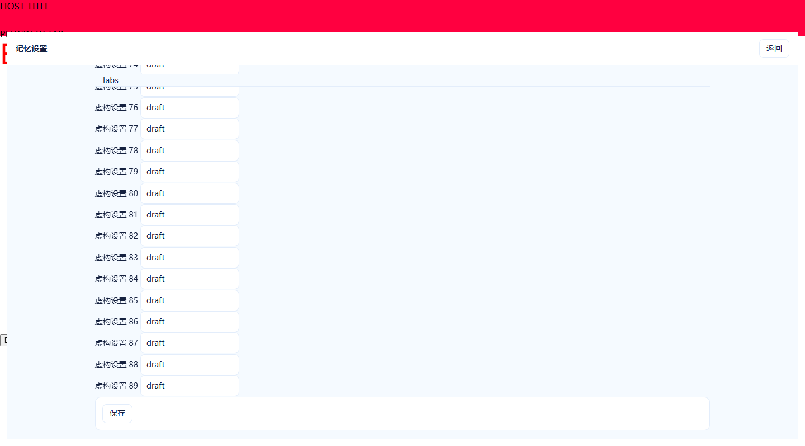
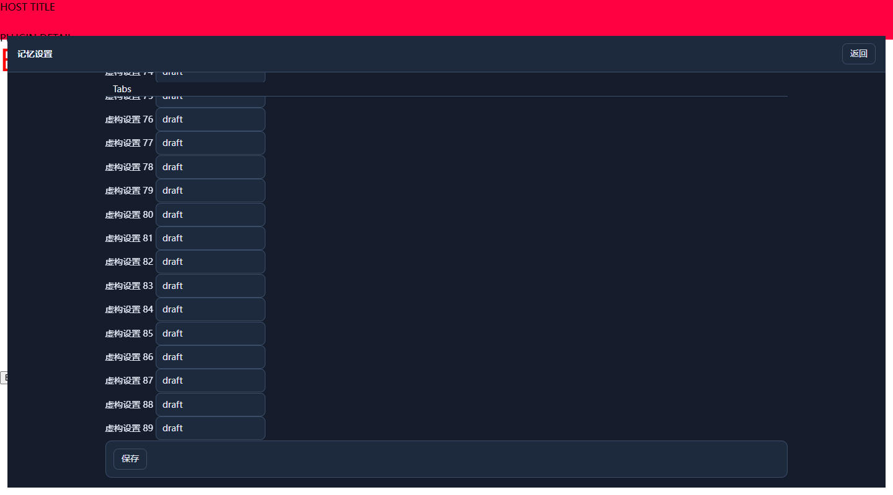

# Claimed issue remediation — 2026-10-14

Upstream: `054942b54d15f46c4421c64d77c8de921e5042ab` (v3.3.3). Fixed scope: #359–#419 excluding PR #394, 60 issues. The candidate includes the existing PR #394 implementation and additional focused fixes. Reviewed means code and isolated regression evidence; it does not mean merge, release or real-host acceptance.

| Issue | State | Commit | Validation / remaining boundary |
|---|---|---|---|
| #359 | reviewed | 8311ce0 | Isolated regression passed; final Spec / Standards review has no remaining finding |
| #360 | reviewed | 8311ce0 | Isolated regression passed; final Spec / Standards review has no remaining finding |
| #361 | reviewed | 758cade | Isolated regression passed; final Spec / Standards review has no remaining finding |
| #362 | reviewed | 8311ce0 | Isolated regression passed; final Spec / Standards review has no remaining finding |
| #363 | reviewed | 8311ce0 | Isolated regression passed; final Spec / Standards review has no remaining finding |
| #364 | reviewed | 758cade | Production fact/unsupported procedure/handoff, atomic receipts, moved-page replay and confirmed cursor reset passed; remote history retention is external |
| #365 | reviewed | 8311ce0 | Isolated regression passed; final Spec / Standards review has no remaining finding |
| #366 | reviewed | 8311ce0 | Isolated regression passed; final Spec / Standards review has no remaining finding |
| #367 | reviewed | 8311ce0 | Isolated regression passed; final Spec / Standards review has no remaining finding |
| #368 | reviewed | 8311ce0 | Isolated regression passed; final Spec / Standards review has no remaining finding |
| #369 | reviewed | 9f6a8c9 | Isolated regression passed; final Spec / Standards review has no remaining finding |
| #370 | reviewed | 8311ce0 | Isolated regression passed; final Spec / Standards review has no remaining finding; real server deduplication acceptance unperformed |
| #371 | reviewed | 8311ce0 | Isolated regression passed; final Spec / Standards review has no remaining finding; POSIX validation separate |
| #372 | reviewed | 8311ce0 | Isolated regression passed; final Spec / Standards review has no remaining finding |
| #373 | reviewed | 4ef7906 | Isolated regression passed; final Spec / Standards review has no remaining finding |
| #374 | reviewed | abb17ba | Isolated regression passed; final Spec / Standards review has no remaining finding |
| #375 | reviewed | 8311ce0 | Isolated regression passed; final Spec / Standards review has no remaining finding |
| #376 | reviewed | 3684606 | Isolated regression passed; final Spec / Standards review has no remaining finding |
| #377 | reviewed | ef36627 | Isolated regression passed; final Spec / Standards review has no remaining finding |
| #378 | reviewed | a75a3e1 | Isolated regression passed; final Spec / Standards review has no remaining finding |
| #379 | reviewed | 4c80c38 | Isolated regression passed; final Spec / Standards review has no remaining finding |
| #380 | reviewed | a75a3e1 | Isolated regression passed; final Spec / Standards review has no remaining finding |
| #381 | reviewed | ae302dc | Isolated regression passed; final Spec / Standards review has no remaining finding |
| #382 | reviewed | 4c80c38 | Isolated regression passed; final Spec / Standards review has no remaining finding |
| #383 | reviewed | 49fb647 | Isolated regression passed; final Spec / Standards review has no remaining finding |
| #384 | reviewed | 4b62c95 | Isolated regression passed; final Spec / Standards review has no remaining finding |
| #385 | reviewed | 49fb647 | Isolated regression passed; final Spec / Standards review has no remaining finding |
| #386 | reviewed | ef36627 | Isolated regression passed; final Spec / Standards review has no remaining finding |
| #387 | reviewed | 758cade | Isolated regression passed; final Spec / Standards review has no remaining finding |
| #388 | reviewed | 49fb647 | Isolated regression passed; final Spec / Standards review has no remaining finding |
| #389 | reviewed | ef36627 | Isolated regression passed; final Spec / Standards review has no remaining finding |
| #390 | reviewed | ef36627 | Isolated regression passed; final Spec / Standards review has no remaining finding |
| #391 | reviewed | ef36627 | Isolated regression passed; final Spec / Standards review has no remaining finding |
| #392 | reviewed | 3684606 | Isolated regression passed; final Spec / Standards review has no remaining finding |
| #393 | reviewed | 3684606 | Isolated regression passed; final Spec / Standards review has no remaining finding |
| #395 | reviewed | dfc7405 | Isolated regression passed; final Spec / Standards review has no remaining finding |
| #396 | reviewed | dfc7405 | Isolated regression passed; final Spec / Standards review has no remaining finding |
| #397 | reviewed | dfc7405 | Isolated regression passed; final Spec / Standards review has no remaining finding |
| #398 | reviewed | dfc7405 | Isolated regression passed; final Spec / Standards review has no remaining finding |
| #399 | reviewed | abb17ba | Isolated regression passed; final Spec / Standards review has no remaining finding |
| #400 | reviewed | 4c80c38 | Isolated regression passed; final Spec / Standards review has no remaining finding |
| #401 | reviewed | 4c80c38 | Isolated regression passed; final Spec / Standards review has no remaining finding |
| #402 | reviewed | 4c80c38 | Isolated regression passed; final Spec / Standards review has no remaining finding |
| #403 | reviewed | abb17ba | Isolated regression passed; final Spec / Standards review has no remaining finding |
| #404 | reviewed | 4c80c38 | Isolated regression passed; final Spec / Standards review has no remaining finding |
| #405 | reviewed | 4c80c38 | Isolated regression passed; final Spec / Standards review has no remaining finding |
| #406 | reviewed | 4c80c38 | Isolated regression passed; final Spec / Standards review has no remaining finding |
| #407 | reviewed | 6defd6a | 48 Chrome fixtures and hook checks passed for dialog/plugin-detail geometry, opacity, focus and scrolling; real DSH visual acceptance unperformed |
| #408 | reviewed | 7acc693 | Isolated regression passed; final Spec / Standards review has no remaining finding; real models/GPU/live host unperformed |
| #409 | reviewed | ae302dc | Isolated regression passed; final Spec / Standards review has no remaining finding; real models/GPU/live host unperformed |
| #410 | reviewed | 7acc693 | Isolated regression passed; final Spec / Standards review has no remaining finding; real models/GPU/live host unperformed |
| #411 | reviewed | 7acc693 | Isolated regression passed; final Spec / Standards review has no remaining finding; real models/GPU/live host unperformed |
| #412 | reviewed | 4ef7906 | Isolated regression passed; final Spec / Standards review has no remaining finding; real models/GPU/live host unperformed |
| #413 | reviewed | 4ef7906 | Isolated regression passed; final Spec / Standards review has no remaining finding; real models/GPU/live host unperformed |
| #414 | reviewed | ae302dc | Isolated regression passed; final Spec / Standards review has no remaining finding; real models/GPU/live host unperformed |
| #415 | reviewed | ae302dc | Isolated regression passed; final Spec / Standards review has no remaining finding; real models/GPU/live host unperformed |
| #416 | reviewed | 684a552 | Isolated regression passed; final Spec / Standards review has no remaining finding; real models/GPU/live host unperformed |
| #417 | reviewed | ae302dc | Isolated regression passed; final Spec / Standards review has no remaining finding; real models/GPU/live host unperformed |
| #418 | reviewed | 0433189 | Isolated regression passed; final Spec / Standards review has no remaining finding; real models/GPU/live host unperformed |
| #419 | reviewed | 0433189 | Isolated regression passed; final Spec / Standards review has no remaining finding; real models/GPU/live host unperformed |

## Validation

- Candidate code: `758cade`. Windows Node 24.15.0 full smoke: **391 PASS / 6 FAIL / 0 TIMEOUT**, 55.6s, with no added exclusions. An initial run had 374 PASS / 23 FAIL; fixture mappings, exact route counts and retained source locks were brought into alignment. The one Windows write-stress failure passed independently and in the final run; it is retained without weakening its assertions.
- Six failures also reproduce against pinned upstream `054942b`: `py-runtime-live` (missing dev venv), `c4-fresh-install` (missing model archive), `m79-feature-v2` / `m710-fv2-emit` (missing configured Python worker interpreter), `v21-path-boundary` / `config-transactions` (Windows file symlink EPERM). These remain failures, not PASS.
- Final independent reviews: Standards 0 remaining findings; Spec 0 after correcting legacy team replay identity so page/field order cannot duplicate a conflict.
- `node --check lib/index.js`, `node --check lib/client.js`, `node tools/build-iter5-skin.mjs --check`, and `npm pack --dry-run` passed. Package contents exclude local UI ZIPs and task backups.
- Settings rendering uses production CSS and the real plugin-detail boundary calculation in an isolated Chrome document. The 48 combinations cover two entry types, 100%/150% scale, three skin choices, light/dark, and 320/1440 widths. They do not reproduce the full installed DSH application.
- No personal memories, active DSH profile, real models or GPU, online team service, release or install were modified for acceptance.

