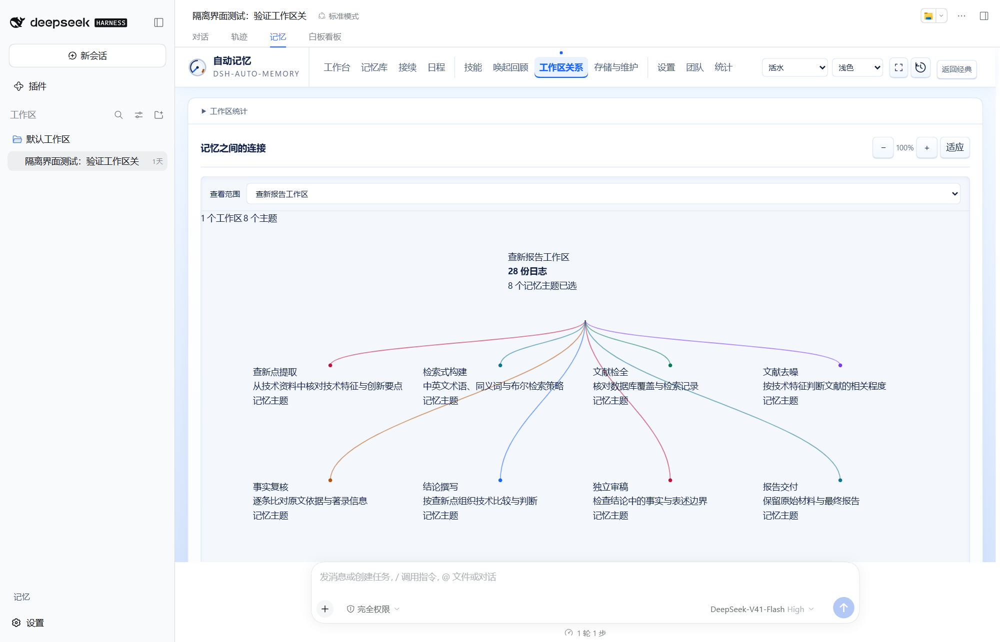
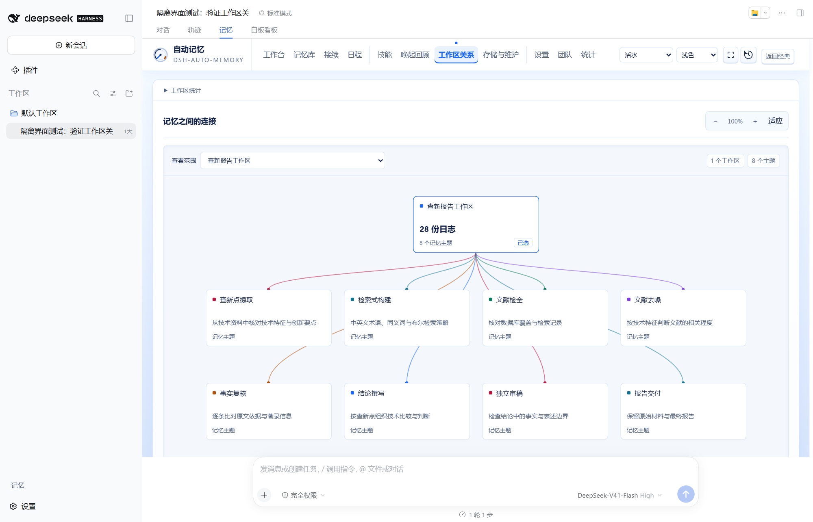
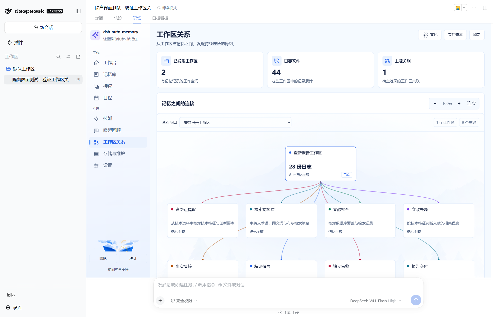
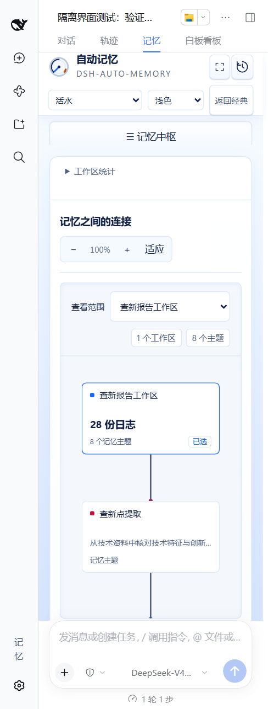
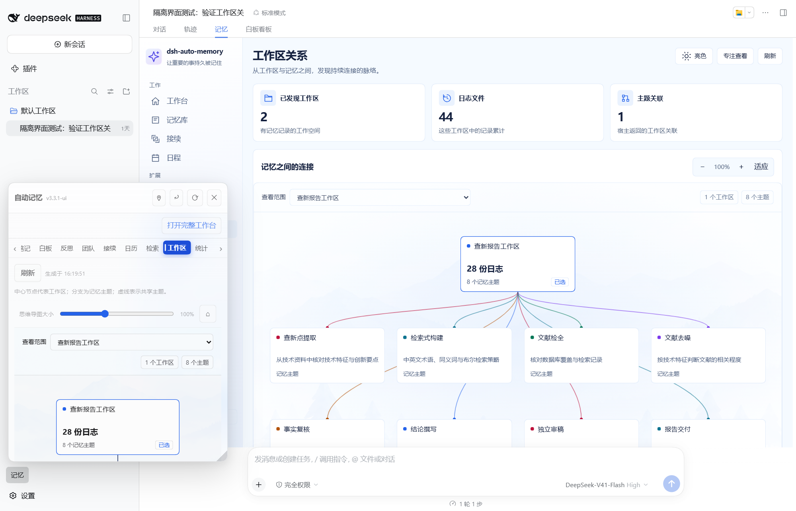
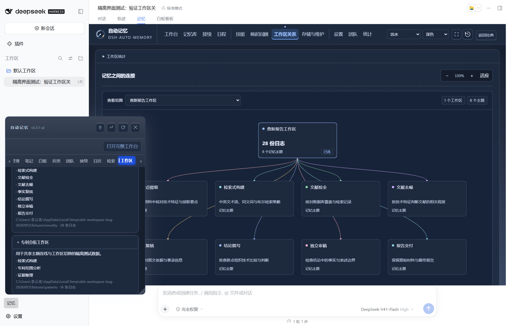

# 工作区关系图集成修复（#354）

2026-10-13，以上游 `7280a3a`（v3.3.2）为修复基线。截图来自隔离 DSH Web 宿主（Edge Chromium），实际加载插件包；没有浏览器路由替换或临时注入样式。全部内容为两个工作区的测试数据，不含用户记忆或客户文档。

## 前后对照

以下两张均为流水皮肤、亮色、1600 × 1028 CSS 像素。同一个隔离配置分别加载实际安装的 v3.3.1 与修复包；流水入口均显示第一个工作区的 8 个主题。

| 安装包：卡片样式缺失 | 修复包：卡片、曲线、工具栏生效 |
| --- | --- |
|  |  |

默认入口改为复用已有卡片渲染器：

390 CSS 像素窄窗口：

小窗初始图卡片完整显示，图卡片背景不透明，滚动范围限制在小窗内：

小窗点击第二个工作区节点后，打开的摘要及其条目进入可视区（深色）：

## 验证边界

- 实际宿主检查：默认、仪表、编辑、流水、经典五种入口，各测嵌入视图的桌面亮色、桌面深色、390px 窄窗口，以及小窗亮色、深色，共 25 个场景；全部通过，无页面运行错误。
- 检查卡片边框、标题行数、外层横向溢出、小窗图卡片 alpha=1、首张卡片完整可见、节点点击后详情完整可见，以及缩放、拖动、复位。点击下方工作区不重置图内滚动；修改查看范围不滚走工具栏。
- `smoke-test-workspace-network-integration.mjs` 执行实际 `lib/client.js` 工厂及样式注入，覆盖默认入口、共享样式、小窗选择与延迟展开的滚动反馈。
- 截图与宿主检查是隔离环境证据；未在用户桌面安装修复，未取得用户视觉验收。
